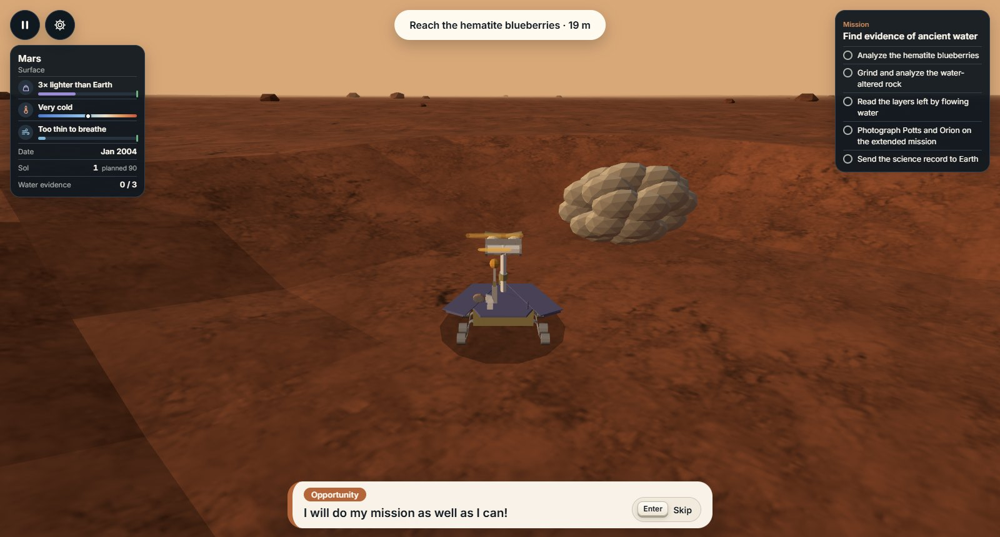
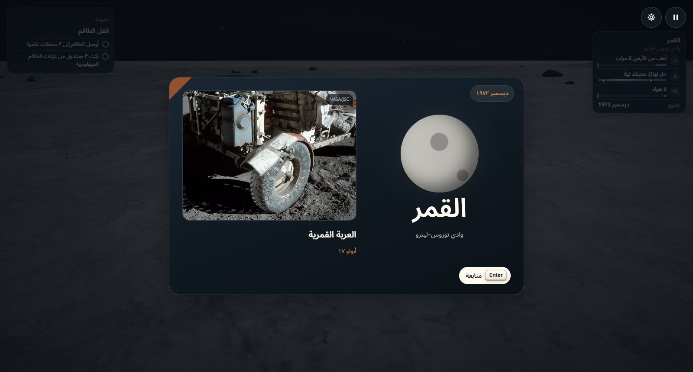

# RELICA: Still Here

**Become the machines NASA left behind, and see the real photographs of what they did.**

A browser-based 3D story game in English and Arabic, made for the **NASA Space Apps Challenge 2026** challenge
**"Abandoned but not Forgotten: Storytelling about NASA's Discarded Equipment on the Moon and Mars"**.

| | |
|---|---|
| **Play it (no install, no login)** | https://relica-pi.vercel.app |
| **Demo (7-slide deck)** | _DEMO LINK: to be added before submission_ |
| **Source code** | https://github.com/MohammedAlkaff123/Relica |
| **All credits and sources** | [CREDITS.md](CREDITS.md) |
| **AI-use disclosure** | [AI_USE.md](AI_USE.md) |



## What it is

NASA's machines on the Moon and Mars were left where their work ended. RELICA lets players *be* those machines for a few
minutes each, so the missions become something they did, not something they read.

Five chapters follow real NASA hardware:

| Chapter | Machine | Where and when | What the player does |
|---|---|---|---|
| Opening | Apollo Lunar Roving Vehicle | Factory clean room, 1971 | Wake up and learn to drive |
| The Moon | Apollo 17 Lunar Roving Vehicle | Taurus–Littrow valley, 1972 | Carry the crew to science stops, mend the broken fender with maps and tape, stay behind when the crew leaves |
| Mars | Opportunity (with a remembered call from Viking 1) | Meridiani Planum, 2004–2018 | Examine three clues of ancient water, photograph Potts and Orion Crater, lose power in the 2018 dust storm |
| The Mars sky | Ingenuity helicopter | Jezero crater, 2021–2024 | Fly, report hazards so Perseverance can change its route, reach flight 72 |
| Far away | Pioneer 10 | Deep space, 1972–2003 | Point the camera at Jupiter, then turn toward Earth to send the picture home |

After each photo task the scene fades into the **original NASA photograph** with its date and credit. The last
screen shows each machine's planned and actual service (Opportunity was planned for 90 sols; Ingenuity was planned
for 5 flights and flew 72).



*Screenshots are captures of the game itself. The photograph on the card is NASA's (as17-137-20979, NASA/JSC).*

## How it answers the challenge

- **Storytelling about discarded equipment:** every chapter ends where the real machine stopped, on the Moon, on Mars or in deep space.
- **Grounded in NASA records:** gravity drives the physics, mission records drive the dates and counters, and each fact links to the NASA page it was checked against ([content/facts.json](content/facts.json)).
- **For young players and classrooms:** it runs in any desktop browser with nothing to install, in English or Arabic. A teacher can play one chapter and ask what the machine measured and why it mattered.

## What is real and what is dramatized

| Real (from NASA sources) | Dramatized |
|---|---|
| Mission dates, places, planned and actual lifetimes | The machines' faces, voices and feelings |
| Gravity of each world, used by the physics | Conversations between machines from different missions |
| The NASA photographs shown after each task | Shortened routes and simplified controls |
| Shapes of the machines (NASA 3D Resources, or built by us after NASA photos) | Pioneer 10 "listening" in the epilogue |

For example, the game says Opportunity found evidence of **past** water, not liquid water today, and calls Viking 1
the first **successful U.S.** Mars landing.

## Play it

Online: **https://relica-pi.vercel.app** (desktop browser with a keyboard: Chrome, Edge or Firefox).

On your own computer (needs only Python 3, no build step, works offline):

```bash
python serve.py
```

Then open http://localhost:5173. Opening `index.html` by double-click does not work, because browsers load the game's
code only from a server.

### Controls

| Key | Action |
|---|---|
| W A S D or arrow keys | Drive or fly |
| Space | Hop (rovers), climb (helicopter), take the photo in a photo task |
| E | Hold or press when the game asks (samples, reporting a hazard) |
| Enter or click | Continue |
| P or Escape | Pause menu (settings: language, graphics, sound) |
| R | Restart the chapter |

## Team

| Name | Role |
|---|---|
| Mohammed Saleh Alkaf | Creative narrator |
| Moayad Bahashwan | Creative director |
| Ziyad Hashem Alshanqiti | Gameplay and engine developer |
| Abdulkarim Aljundubi | World and character designer |
| Abdullatif Al-Khanbashi | UX and sound designer (team owner) |

## NASA data

| NASA source | How the game uses it |
|---|---|
| [NASA 3D Resources](https://github.com/nasa/NASA-3D-Resources) | Opportunity, Ingenuity, Viking and Pioneer 10 models and the astronaut, simplified (see [public/models/README.md](public/models/README.md)) |
| [NASA Image and Video Library](https://images.nasa.gov) | The original photographs revealed after each task ([public/nasa/CREDITS.csv](public/nasa/CREDITS.csv)) |
| [NASA Photojournal: Mineral tells tale of watery past](https://science.nasa.gov/photojournal/mineral-tells-tale-of-watery-past/) | Opportunity's water evidence |
| [NASA Planetary Fact Sheet: Moon](https://nssdc.gsfc.nasa.gov/planetary/factsheet/moonfact.html) | Moon gravity, temperature and air |
| [NASA Planetary Fact Sheet: Mars](https://nssdc.gsfc.nasa.gov/planetary/factsheet/marsfact.html) | Mars gravity, temperature and air |
| [Apollo Lunar Surface Journal: Apollo 17 fender repair](https://www.hq.nasa.gov/alsj/a17/A17NewFender.html) | The fender repair mission |
| [NASA: Apollo Lunar Roving Vehicle](https://nssdc.gsfc.nasa.gov/planetary/lunar/apollo_lrv.html) | The Moon rover's facts |
| [NASA Science: Opportunity](https://science.nasa.gov/mission/mer-opportunity/) | Mars chapter dates and service |
| [NASA Science: Ingenuity Mars Helicopter](https://science.nasa.gov/mission/mars-2020-perseverance/ingenuity-mars-helicopter/) | Flights planned and flown |
| [NASA Science: Viking 1](https://science.nasa.gov/mission/viking-1/) | Viking's landing and service |
| [NASA Science: Pioneer 10](https://science.nasa.gov/mission/pioneer-10/) | Pioneer's Jupiter flyby and last signal |
| [NASA Science: Opportunity's last message](https://science.nasa.gov/resource/opportunitys-last-message/) | The end of the Mars chapter |

Every other fact source is the `source` link next to that fact in [content/facts.json](content/facts.json),
[content/discoveries.json](content/discoveries.json) and [content/memories.json](content/memories.json).
The complete list, with every outside resource and its licence, is in [CREDITS.md](CREDITS.md).

## Other resources

| Resource | Licence | Use |
|---|---|---|
| [Three.js](https://threejs.org) 0.160.0 | MIT | 3D rendering |
| [Rapier](https://rapier.rs) 0.12.0 | Apache-2.0 | Physics |
| [lil-gui](https://lil-gui.georgealways.com) 0.19.2 | MIT | Team tuning panel |
| [Poly Haven](https://polyhaven.com/license) textures (Sand 01, Blue Metal Plate) | CC0 | Ground and metal surface detail |
| [Inter](https://rsms.me/inter/) | SIL Open Font License | Interface font |
| [Noto Sans Arabic](https://fonts.google.com/noto/specimen/Noto+Sans+Arabic) | SIL Open Font License | Arabic interface font |
| NASA Space Apps Challenge logos | Official event logo pack | Landing page and credits |
| Web Audio API | Browser feature | Every sound, voice and piece of music is generated in code; no audio files |

## Use of AI

AI tools helped the team with code, debugging, writing, translation, research and the presentation. Each use is
listed with the person and the tool in [AI_USE.md](AI_USE.md). The idea and the story are the team's own.
No AI-generated images, video or audio are in the game; the logo was designed as simple vector shapes with AI help
(disclosed in [AI_USE.md](AI_USE.md)).

## More

- [CREDITS.md](CREDITS.md): every NASA source and every outside resource
- [docs/DEVELOPERS.md](docs/DEVELOPERS.md): code layout and how chapters work
- [docs/team/](docs/team/): the team's planning and hand-off notes
- [pitch/](pitch/): presentation material
