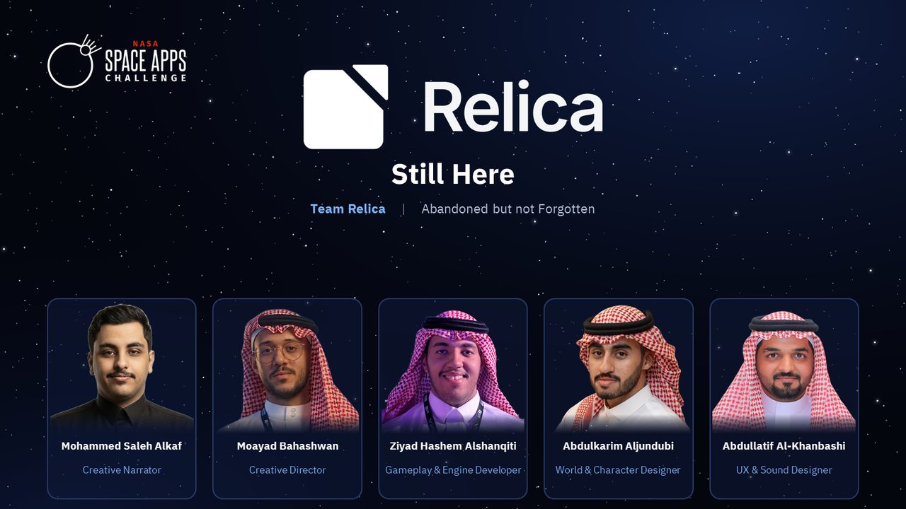
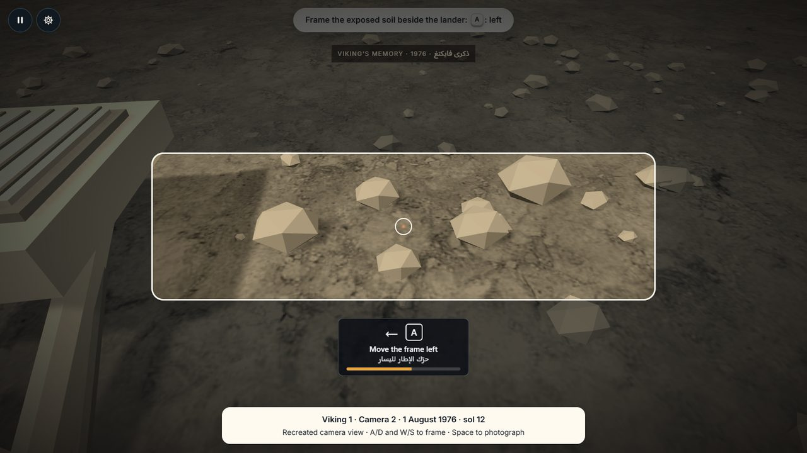
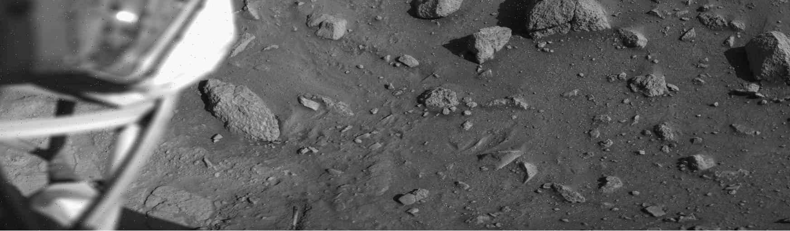
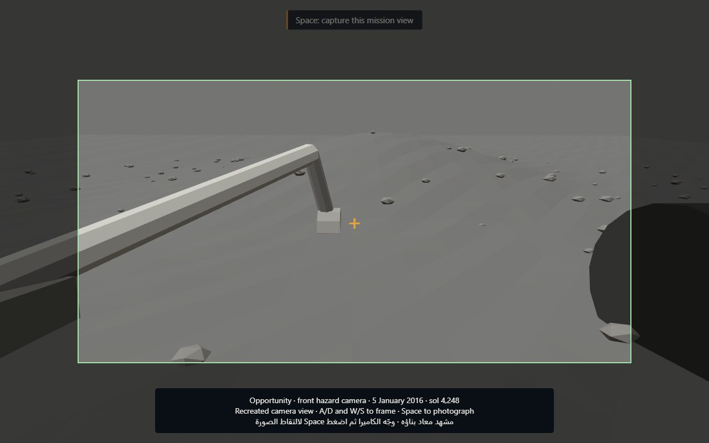
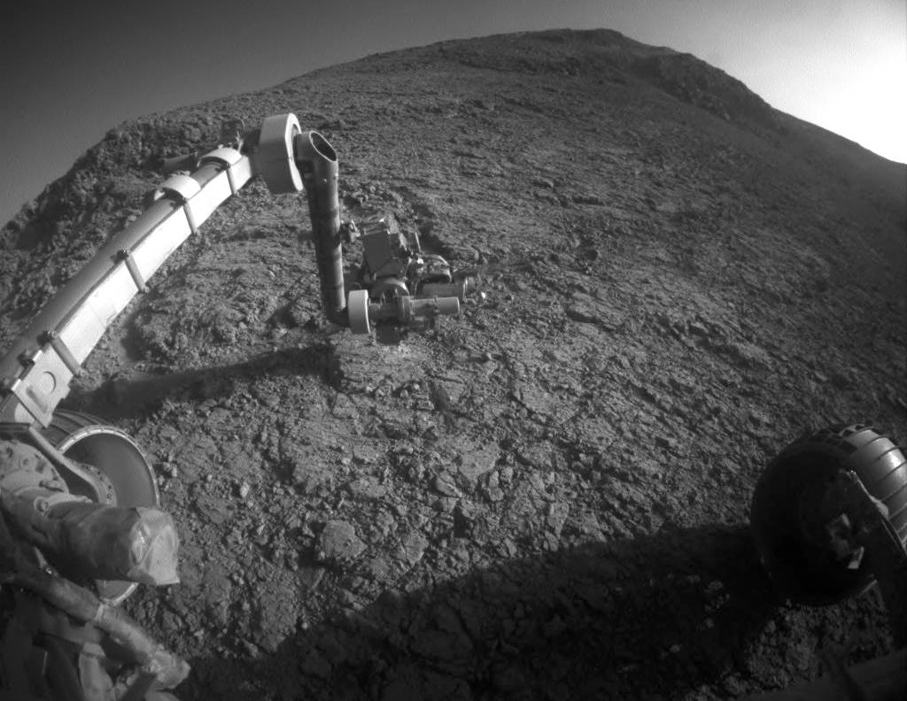
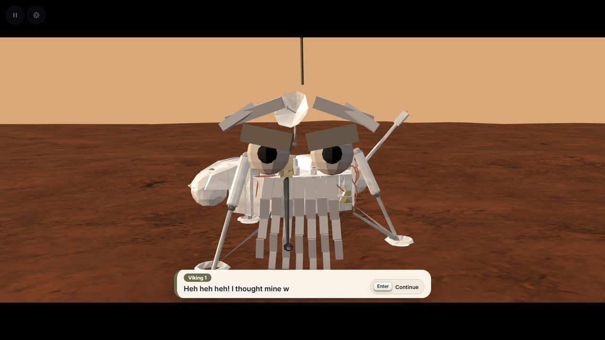
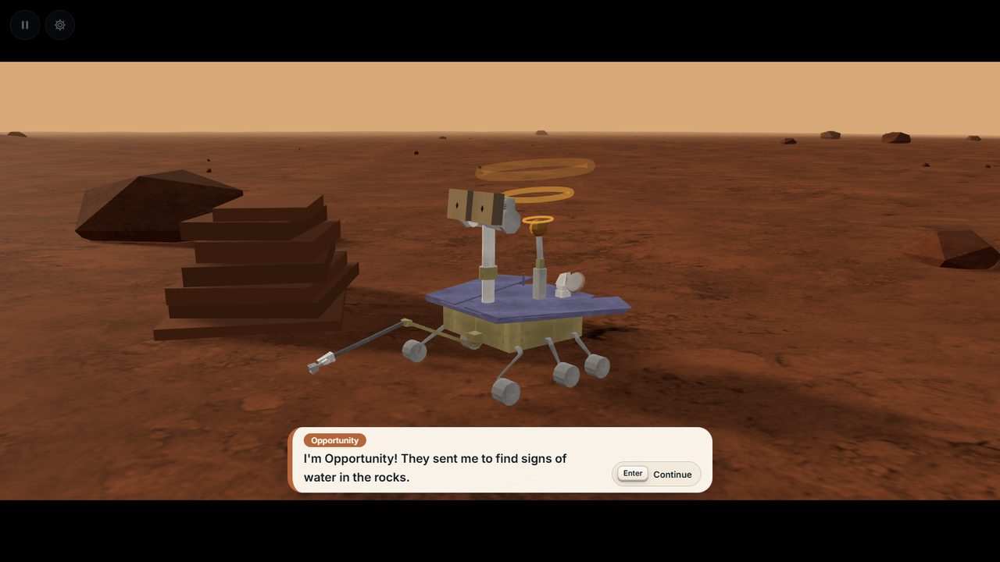
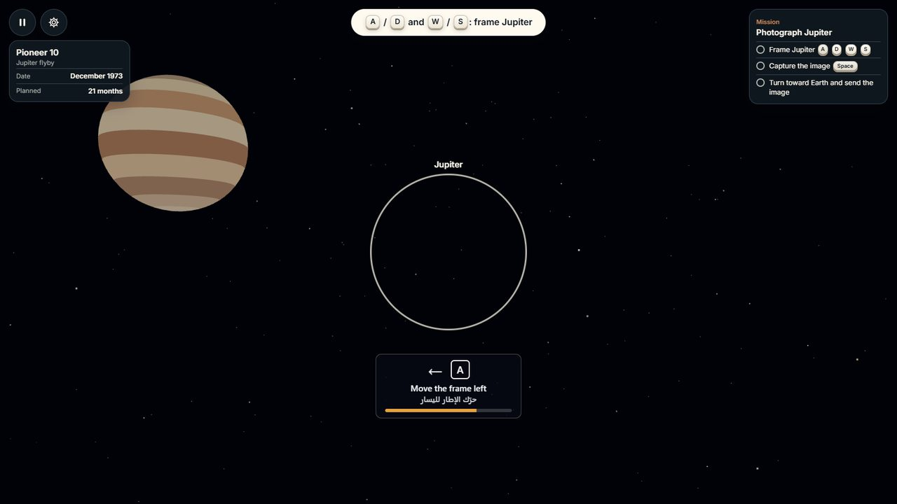

<div align="center">

# RELICA: Still Here

**Play as the machines NASA left behind, do their real jobs, then see the real NASA photo.**

[](https://www.spaceappschallenge.org)
[](https://threejs.org)
[](https://rapier.rs)
[](https://relica-pi.vercel.app)
[](#how-it-plays)

**[▶ Play now](https://relica-pi.vercel.app)** &nbsp;·&nbsp; **[Watch the 30-second demo](https://youtu.be/ljCjr-8vD4M)** &nbsp;·&nbsp; **[Source code](https://github.com/MohammedAlkaff123/Relica)**



</div>

## The challenge

**[Abandoned but not Forgotten: Storytelling about NASA's Discarded Equipment on the Moon and Mars](https://www.spaceappschallenge.org)**, NASA Space Apps Challenge 2026.

Rovers, landers and helicopters that changed what we know about the Moon and Mars are still out there, parked where their work ended. Most young people have never heard their stories, and a fact sheet alone rarely makes anyone care.

## What Relica is

Relica is a short 3D story game that runs in the browser. In each chapter you **become one of those machines** and carry out its real mission: drive the crew, fix a broken fender, look for signs of ancient water, scout a safe route from the air, point a camera at Jupiter. When a photo task is done, the scene fades into **the original NASA photograph** of that moment, with its date and credit. The game ends on a wall that compares each machine's planned service with what it actually achieved.

## The five machines

| Machine | Where | Years | What you do |
|---|---|---|---|
| **Apollo 17 Lunar Roving Vehicle** | The Moon, Taurus–Littrow valley | 1972 | Carry the crew to science stops, mend the broken fender with maps and tape, stay behind when the crew leaves |
| **Viking 1** | Mars, Chryse Planitia | 1976–1982 | In a remembered scene, frame the soil beside the lander for its sol 12 photo, then talk to Opportunity |
| **Opportunity** | Mars, Meridiani Planum | 2004–2018 | Examine three clues of ancient water, photograph the Potts target and Orion crater, lose power in the 2018 dust storm (planned: 90 sols) |
| **Ingenuity** | The Mars sky, Jezero crater | 2021–2024 | Fly, report hazards so Perseverance can change its route, keep flying to flight 72 (planned: 5 flights) |
| **Pioneer 10** | Deep space | 1972–2003 | Frame Jupiter for the December 1973 flyby image, then turn toward Earth to send it home |

## From mission to the real photo

Every photo task recreates a real NASA photograph. Left: the game. Right: NASA's original.

| In the game | NASA's photo |
|---|---|
|  |  |
| Viking 1 frames the ground beside its footpad (camera 2, sol 12). | *Mars Surface near Viking Lander 1 Footpad.* NASA/JPL, [PIA10738](https://images.nasa.gov/details/PIA10738) |
|  |  |
| Opportunity frames the Potts rock target through its front hazard camera. | *Mars Rover Opportunity at Rock Abrasion Target Potts.* NASA/JPL, [PIA20285](https://images.nasa.gov/details/PIA20285) |

### More from the game

| | |
|---|---|
|  |  |
| Viking 1 in its imagined call with Opportunity | Opportunity: "find signs of water in the rocks" |
|  |  |
| Pioneer 10 lines up its camera on Jupiter | Driving Opportunity: world panel, mission list and dialogue |

*All screenshots are captures of the game itself. The title image is the first slide of the team's deck.*

## How it plays

It runs in any current desktop browser (Chrome, Edge, Firefox) with nothing to install. Switch between **English and Arabic** at any time from the landing page, the main menu or Settings; every word of the interface changes, including right-to-left layout.

| Key | Action |
|---|---|
| W A S D or arrow keys | Drive or fly |
| Space | Hop (rovers) or climb (helicopter) |
| E (hold) | Act when the game asks: take a sample, secure a box, report a hazard |
| Enter or click | Continue |
| A / D and W / S, then Space | In a photo task: line up the view, then take the photo |
| P or Escape | Pause menu and settings (language, graphics, sound) |

Progress is saved on the device, so **Continue** picks up from the last chapter reached.

## NASA data used

| NASA source | Used in the game for |
|---|---|
| [NASA 3D Resources](https://github.com/nasa/NASA-3D-Resources) | The Opportunity, Ingenuity, Viking and Pioneer 10 models and the astronaut, simplified and with all logos and flags removed |
| [NASA Image and Video Library](https://images.nasa.gov) | The original photographs revealed after each photo task, on the chapter cards and on the memory wall |
| [NASA Photojournal: Mineral Tells Tale of Watery Past](https://science.nasa.gov/photojournal/mineral-tells-tale-of-watery-past/) | Opportunity's evidence of ancient water |
| [NASA Planetary Fact Sheet: Moon](https://nssdc.gsfc.nasa.gov/planetary/factsheet/moonfact.html) | Moon gravity in the physics engine, and the world panel |
| [NASA Planetary Fact Sheet: Mars](https://nssdc.gsfc.nasa.gov/planetary/factsheet/marsfact.html) | Mars gravity in the physics engine, and the world panel |
| [Apollo Lunar Surface Journal: Apollo 17 fender repair](https://www.hq.nasa.gov/alsj/a17/A17NewFender.html) | The fender repair mission on the Moon |
| [NASA: Apollo Lunar Roving Vehicle](https://nssdc.gsfc.nasa.gov/planetary/lunar/apollo_lrv.html) | The Moon rover chapter and its mission card |
| [NASA Science: Opportunity](https://science.nasa.gov/mission/mer-opportunity/) | Mars chapter dates, planned and actual service |
| [NASA Science: Opportunity's last message](https://science.nasa.gov/resource/opportunitys-last-message/) | The end of the Mars chapter |
| [NASA Science: Ingenuity Mars Helicopter](https://science.nasa.gov/mission/mars-2020-perseverance/ingenuity-mars-helicopter/) | Flights planned and flown, the final flight |
| [NASA Science: Viking 1](https://science.nasa.gov/mission/viking-1/) | Viking 1's landing and service |
| [NASA Science: Pioneer 10](https://science.nasa.gov/mission/pioneer-10/) | The Jupiter flyby and the last signal |

Full credit files: [CREDITS.md](CREDITS.md) (every source in one place), [public/nasa/CREDITS.csv](public/nasa/CREDITS.csv) (each photo with its NASA ID and source page), [public/models/README.md](public/models/README.md) (each model and what was changed). Every fact in [content/facts.json](content/facts.json) links to the NASA page it was checked against.

## Accuracy: what is real and what is dramatized

| Real, from NASA sources | Dramatized |
|---|---|
| Mission dates, places, planned and actual lifetimes | The machines' faces, voices and feelings |
| The gravity of each world, used by the physics | Conversations between machines from different missions |
| The NASA photographs, shown with their credit | Shortened routes and simplified controls |
| The shape of each machine | Pioneer 10's part in the final conversation |

Where wording matters, the game is careful: Opportunity found evidence of **past** water, not liquid water today, and Viking 1 was the first **successful U.S.** landing on Mars.

## Tech stack

- **JavaScript** ES modules with **no build step**: what is in the repository is exactly what the browser runs
- **[Three.js](https://threejs.org) 0.160.0** for 3D rendering, **[Rapier](https://rapier.rs) 0.12.0** for 3D physics, **[lil-gui](https://lil-gui.georgealways.com)** for the team's tuning panel, all bundled in `vendor/` so the game works offline
- **Web Audio API**: every sound, voice and music cue is generated in code; there are no audio files
- **HTML and CSS** interface in English and Arabic, with right-to-left layout
- Every asset is **preloaded into memory** before play, with a real progress bar
- **Python** dev server for local play, **[Vercel](https://vercel.com)** for the public link

## Run it locally

You only need Python 3.

```bash
git clone https://github.com/MohammedAlkaff123/Relica.git
cd Relica
python serve.py
```

Then open http://localhost:5173. (Opening `index.html` directly does not work: browsers only load the game's modules from a server.)

Useful address options:

| Option | Effect |
|---|---|
| `?lang=en` or `?lang=ar` | Pick the language for this visit |
| `?mute` | Start with the sound off |
| `?chapter=2` (1 to 5) or `?chapter=mars` | Start straight in a chapter |
| `?jump=fender`, `viking`, `storm` or `flight72` | Start at a key moment inside a chapter |

## Project structure

```
index.html, style.css   landing page, loader, game shell and interface styles
src/                    the game: chapters, physics, vehicles, characters, worlds, interface, audio
content/                facts with NASA sources, dialogue, missions, discoveries, chapter cards (English + Arabic)
public/nasa/            NASA photographs used in the game, with metadata.json and CREDITS.csv
public/models/          3D models (NASA 3D Resources, simplified) with their README
public/textures/        ground and metal textures (Poly Haven, CC0)
public/brand/           Relica logo, fonts and the Space Apps logo
vendor/                 Three.js, Rapier and lil-gui
nasa_data/              the team's full NASA reference pack
tools/                  scripts that build the models, textures and preload list
docs/                   images for this page, developer notes, team notes
pitch/                  presentation material
serve.py                local server
```

## Team

| Name | Role |
|---|---|
| Mohammed Saleh Alkaf | Creative Narrator |
| Moayad Bahashwan | Creative Director |
| Ziyad Hashem Alshanqiti | Gameplay & Engine Developer |
| Abdulkarim Aljundubi | World & Character Designer |
| Abdullatif Al-Khanbashi | UX & Sound Designer |

## Credits and licences

The code libraries are MIT (Three.js, lil-gui) and Apache-2.0 (Rapier). The fonts (Inter and Noto Sans Arabic) are under the SIL Open Font License, the textures are Poly Haven CC0, and the NASA material follows NASA's media usage guidelines. Using it does not imply endorsement by NASA. The full list, with every link and licence, is in **[CREDITS.md](CREDITS.md)**.

## Use of AI

The team used AI tools (Claude Code, Codex, ChatGPT) as assistants for code and debugging, drafting and editing text, Arabic–English translation, checking NASA sources, and building the presentation. The idea, the story and the final choices are the team's own. There are no AI-generated images, video or audio in the game. Every use is logged with the person and the tool in **[AI_USE.md](AI_USE.md)**.

## Scan to watch or play

| Demo video | Live demo |
|:---:|:---:|
| <a href="https://youtu.be/ljCjr-8vD4M"></a> | <a href="https://relica-pi.vercel.app"></a> |
| [youtu.be/ljCjr-8vD4M](https://youtu.be/ljCjr-8vD4M) | [relica-pi.vercel.app](https://relica-pi.vercel.app) |
